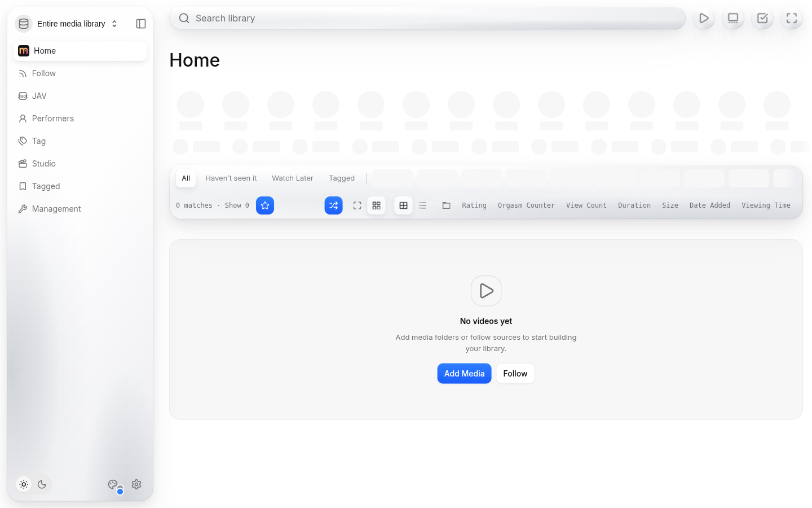
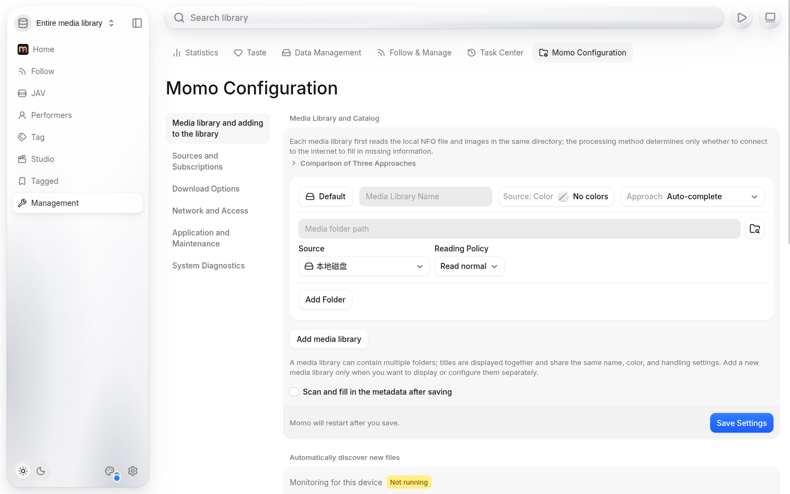
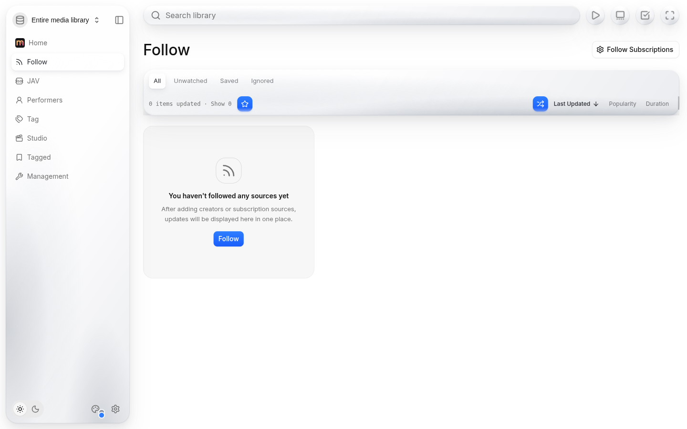

<p align="center"></p>

# Momo

Momo is Peach in English: a fork of [Peach](https://github.com/peach-mitao/peach), the self-hosted JAV metadata scraper and media manager, with the same features.

Peach's interface is Chinese only. Momo translates every page, button, setting, error message and log line, so you can run it without a translator open in another tab.

Momo is an independent fork. The Peach project did not make it and does not endorse it. Please report Momo problems on [Momo's issue tracker](https://github.com/SinnerCode/momo/issues), not to Peach.



<details>
<summary>More screenshots</summary>





</details>

## What you get

- Metadata scraping: recognizes video codes (番号), reads NFO files, and fills in titles, actresses, studios, series, tags and covers from several sources. Your own edits are kept.
- Local and cloud libraries: browse local drives, SMB shares, mounted cloud storage (CloudDrive2, 115, PikPak) and NAS folders in one library.
- Playback: a web player with subtitles, speed control, rotation, resume and timeline previews, plus external players.
- Follows and discovery: track actresses, studios and creators, see new releases, and keep a want list.
- Library management: tags, duplicates, versions, multi-part videos and watch history, all stored on your own machine.

Genre and tag names that come from scraped sites stay in their original language, because Momo matches them against the stored data.

## Run it with Docker

Momo runs as one container. It works on any Linux server, NAS (Synology, Unraid, TrueNAS, fnOS) or VPS that runs Docker.

```yaml
# compose.yaml
services:
  momo:
    image: ghcr.io/sinnercode/momo:0.52.0
    init: true
    restart: unless-stopped
    stop_grace_period: 75s
    ports:
      - "127.0.0.1:8900:8900"   # use your LAN IP instead of 127.0.0.1 for LAN access
    volumes:
      - momo-data:/data
      - /path/to/your/videos:/media:ro
volumes:
  momo-data:
```

1. Run `docker compose up -d`.
2. Run `docker compose exec momo peach token` to print the first-login token.
3. Open `http://<server>:8900`, log in with the token, then set an access password.
4. In **Momo Configuration**, add `/media` as a media folder and save with scanning turned on.

The container runs as UID 1000, so that user must be able to read your video folder. Hardware transcoding, CloudDrive2 and the other options work exactly as in [Peach's Docker guide](../docs/DOCKER.md) (in Chinese).

### Behind a reverse proxy

The settings pages refuse requests that carry proxy headers, and they check the page origin. If you put Momo behind Caddy or nginx, strip those headers and rewrite an HTTPS origin to HTTP. Caddy example:

```caddyfile
momo.example.lan {
	reverse_proxy momo:8900 {
		header_up -X-Forwarded-*
		header_up -Forwarded
		header_up Origin "^https://momo\.example\.lan$" "http://momo.example.lan"
	}
}
```

Keep Momo on your LAN or a VPN such as Tailscale. Like Peach, it is a single-user app with no accounts, and it should not face the public internet.

## How the translation works

Momo does not change Peach's source files, so each new Peach release merges cleanly. The English build happens when the image is made:

- `i18n/py.py` and `i18n/ts.mjs` parse the Python backend and the TypeScript frontend, and swap each Chinese interface string for its English version from `i18n/en.json`.
- Strings the code uses as data (comparisons, lookups, tag names) are left alone, so nothing breaks.
- `i18n/translate.py` fills `en.json` through DeepL with a glossary of library terms. Only new strings are sent.
- `i18n/Dockerfile` builds on top of the official Peach image for the same release.

See [`i18n/README.md`](../i18n/README.md) to update or build it yourself.

## License

AGPL-3.0-or-later, the same as Peach. Momo's source, including the translation tooling, is this repository. Peach's name and icon belong to the Peach project (see its [name policy](../docs/TRADEMARKS.md)); Momo uses its own name and icon. Adults only: Momo is for legally released content featuring consenting adults.

<sub>Search terms: Peach English, Peach English version, Peach in English, Peach global version, Peach international version, Peach 英文版, peach-mitao English, peach.video English, English JAV metadata scraper, JAV library manager, self-hosted JAV media server, JAV NFO scraper, Docker, NAS.</sub>
